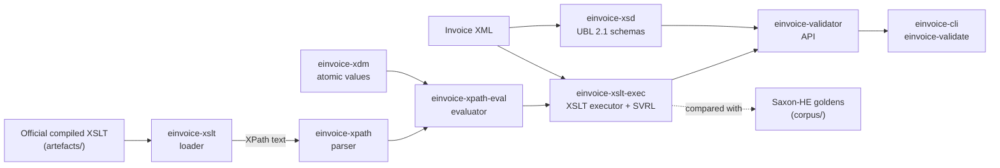

# einvoice-validator

Validate EN 16931 and Peppol BIS Billing 3.0 e-invoices against the **official** validation
artefacts, in pure Rust: no JVM, no C library, no FFI.

[](https://github.com/einvoice-validator/einvoice-validator/actions/workflows/ci.yml)
[](LICENSE)

## Status

**Pre-alpha, no release yet:** nothing is published on crates.io; build from source (see
[Usage](#usage)). The library and the `einvoice-validate` command-line tool validate UBL 2.1
invoices and credit notes: the XML, the UBL 2.1 schema, then the official stylesheets of the rule
set. The CEN EN 16931 UBL 1.3.17 rule set is built in; Peppol BIS Billing 3.0.22 (its own rules
and the CEN rules it embeds) is used as a bundle built locally, since its files may not be
redistributed. On every case of the test corpora of both rule sets, the engine produces the same
SVRL report as Saxon-HE.

| Part | State |
|---|---|
| Test corpus of CEN EN 16931 UBL 1.3.17 (1179 cases) with the Saxon-HE results for each case | done |
| `einvoice-xdm`: XPath 2.0 atomic values with exact decimals, checked against Saxon-HE | done |
| `einvoice-xpath`: parser of the XPath 2.0 subset; parses every expression of the CEN 1.3.17 stylesheet | done |
| `einvoice-xslt`: loader of the XSLT 2.0 subset; loads the CEN 1.3.17 stylesheet | done |
| `einvoice-xpath-eval`: XPath 2.0 evaluator; agrees with Saxon-HE on every distinct expression of the CEN 1.3.17 stylesheet at nodes of corpus documents | done |
| `einvoice-xslt-exec`: XSLT executor and SVRL output | done |
| Same results as Saxon-HE on the whole CEN corpus | done: 1179 / 1179 cases identical; own mutation cases to come ([#3](https://github.com/einvoice-validator/einvoice-validator/issues/3)) |
| Test corpus of Peppol BIS Billing 3.0.22 (707 cases), built locally from the pinned release (not redistributed) with the Saxon-HE results of both stylesheets | done ([#4](https://github.com/einvoice-validator/einvoice-validator/issues/4)) |
| Same results as Saxon-HE on the whole Peppol corpus | done: 707 / 707 cases identical with each of the two stylesheets ([#5](https://github.com/einvoice-validator/einvoice-validator/issues/5)) |
| `einvoice-xsd`: UBL 2.1 XML Schema validation against the official OASIS schemas; compared with xmllint on 1546 cases, every corpus case agrees, the other differences are listed with their cause | done ([#6](https://github.com/einvoice-validator/einvoice-validator/issues/6) follow-ups) |
| Public API (`einvoice-validator`: rule-set bundles, `Validator`, `Report`) and command-line tool (`einvoice-validate`); verdicts and findings agree with Saxon-HE on all 1179 CEN cases and, with the Peppol bundle, on all 707 Peppol cases | done ([#10](https://github.com/einvoice-validator/einvoice-validator/issues/10)) |
| WebAssembly build | pending: the library compiles for `wasm32-unknown-unknown` (checked in CI); not usable there yet ([#9](https://github.com/einvoice-validator/einvoice-validator/issues/9)) |
| Other rule sets (CEN CII, XRechnung, Factur-X / ZUGFeRD) | planned ([#12](https://github.com/einvoice-validator/einvoice-validator/issues/12)) |

Every open item is tracked in the [issues](https://github.com/einvoice-validator/einvoice-validator/issues);
changes are listed in [CHANGELOG.md](CHANGELOG.md).

## Usage

There is no release yet: install the command-line tool from a clone of this repository (the
toolchain is pinned in `rust-toolchain.toml` and installed by rustup on first use).

```sh
cargo install --locked --path crates/einvoice-cli    # installs einvoice-validate
einvoice-validate invoice.xml                        # CEN EN 16931 UBL 1.3.17, the built-in rule set
einvoice-validate --format json --jobs 4 invoices/*.xml > report.json
einvoice-validate --format svrl - < invoice.xml      # the SVRL report, as the stylesheet wrote it
einvoice-validate --bundle DIR invoice.xml           # a rule-set bundle: DIR/bundle.toml and its stylesheets
```

```text
$ einvoice-validate invoice.xml broken.xml
invoice.xml: valid
broken.xml: invalid: 1 schema error, 11 fatal
  schema   2:1: missing-element: element ubl:Invoice: content incomplete; expected: ext:UBLExtensions, cbc:UBLVersionID, cbc:CustomizationID, cbc:ProfileID, cbc:ProfileExecutionID, cbc:ID
  ...
  fatal    BR-02: [BR-02]-An Invoice shall have an Invoice number (BT-1).
           at /*:Invoice[namespace-uri()='urn:oasis:names:specification:ubl:schema:xsd:Invoice-2'][1]
  ...
2 documents: 1 valid, 1 invalid, 0 not validated
```

Exit status, the highest that applies: `0` every document is valid (no schema error, no finding
with flag `fatal`); `1` a document is invalid (schema errors, fatal findings, or not well-formed
XML); `2` usage error, or a file or bundle that cannot be read or is not valid; `3` a construct
the engine does not support, a stylesheet error on a document, or an internal error. The options,
the output formats and the JSON format (versioned) are documented in
[`crates/einvoice-cli/README.md`](crates/einvoice-cli/README.md).

**Peppol BIS Billing 3.0.** Its files carry no licence, so they are not part of this repository:
`scripts/fetch-peppol.sh` (needs Java and network access the first time) downloads the pinned
release, compiles its two stylesheets and writes, next to them, the `bundle.toml` that names
them with their checksums. The directory is then a bundle:

```sh
scripts/fetch-peppol.sh                     # into target/peppol/
einvoice-validate --bundle target/peppol/peppol-bis-billing-ubl-3.0.22 invoice.xml
```

**Library.** A `Validator` is built once from a rule set (schemas loaded, stylesheets prepared),
is `Send + Sync`, and validates any number of documents. With no release yet, depend on the
repository:

```toml
[dependencies]
einvoice-validator = { git = "https://github.com/einvoice-validator/einvoice-validator" }
```

```rust
use einvoice_validator::{Validator, Verdict};

fn main() -> Result<(), Box<dyn std::error::Error>> {
    // Built once: the UBL 2.1 schemas loaded, the CEN stylesheet prepared.
    // A Validator is Send + Sync: share it between threads.
    let validator = Validator::cen_ubl()?;
    let report = validator.validate(&std::fs::read("invoice.xml")?)?;
    for error in &report.schema_errors {
        println!("schema {}:{}: {}", error.line, error.column, error.message);
    }
    for finding in report.findings() {
        let id = finding.id.as_deref().unwrap_or("-");
        println!("{:?} {id}: {} (at {})", finding.severity, finding.text, finding.location);
    }
    println!("{}", if report.verdict() == Verdict::Valid { "valid" } else { "invalid" });
    Ok(())
}
```

`Validator::from_bundle_dir` loads a bundle directory such as the Peppol one; the manifest format
is documented in the crate.

## Design

- **The official artefacts, unchanged.** The rule sets are published by their owners (CEN/TC 434,
  OpenPeppol) as Schematron, compiled to XSLT by CEN; the Peppol Schematron is compiled here
  with the ISO Schematron skeleton of ph-schematron, the output pinned by checksum. The engine
  is built to execute that compiled XSLT as is: no rule is translated into Rust by hand, so a
  new rule-set release needs new artefacts and new expected results, not new code.
- **Pure Rust.** No JVM, no C library, no FFI; `unsafe` code is forbidden in every crate.
- **Exact decimals.** `xs:decimal` and `xs:integer` are arbitrary precision, with the division
  precision, rounding and string forms of the reference engine: the amount and total rules
  compute exactly what Saxon-HE computes, never through floating point where the stylesheet
  asks for decimals.
- **Checked rule by rule against the reference engine.** The expected result of every test case
  is the SVRL report of Saxon-HE 12.10 running the same stylesheet, stored in a canonical
  text form. The goal is identical reports: the same fired rules, the same failed asserts and
  successful reports with the same id, flag, location and text, in the same order.
- **Loud refusal.** The engine implements the XPath and XSLT subset the official stylesheets
  use, and nothing is approximated: a construct outside that subset is an error at load time
  that names it and its line, and a value whose reference behaviour is not reproduced is
  refused rather than guessed.

## Rule sets and schemas

| Rule set or schema | Version | In this repository |
|---|---|---|
| CEN EN 16931, UBL syntax | 1.3.17 | Artefacts vendored unmodified in `artefacts/`; test corpus and Saxon-HE results in `corpus/`. Built into `einvoice-validator` as the rule set `cen-ubl` (default feature `cen-ubl`). |
| Peppol BIS Billing 3.0, UBL syntax | 3.0.22 | Not vendored: the upstream repository publishes no licence. `scripts/fetch-peppol.sh` fetches the pinned tag and compiles its two Schematron files to XSLT (ISO skeleton of ph-schematron) into `target/peppol/`, every input and output checked against a pinned checksum, with the `bundle.toml` that makes the directory a rule-set bundle; `scripts/check.sh peppol` builds the corpus and the Saxon-HE results there. |
| CEN EN 16931 CII, XRechnung, Factur-X / ZUGFeRD | | Planned. |
| OASIS UBL 2.1 schemas (Invoice, CreditNote) | 2.1 | Vendored unmodified in `crates/einvoice-xsd/schemas/`; `einvoice-xsd` validates against them. |

The pinned versions are listed in `upstream.toml`; a weekly workflow reports newer upstream
releases.

## How it works



| Crate | Role |
|---|---|
| [`einvoice-xdm`](crates/einvoice-xdm) | Atomic values of the XPath 2.0 data model: exact `xs:decimal` and `xs:integer`, `xs:double`, dates, casts, arithmetic, comparisons and XSD regular expressions, with the behaviour of Saxon-HE 12.10. |
| [`einvoice-xpath`](crates/einvoice-xpath) | Parser and syntax tree for the XPath 2.0 subset, XSLT match patterns, sequence types and attribute value templates. |
| [`einvoice-xpath-eval`](crates/einvoice-xpath-eval) | Node model and evaluator of the XPath 2.0 subset, with the behaviour of Saxon-HE 12.10; unknown functions and variables are refused when an expression is compiled. |
| [`einvoice-xslt`](crates/einvoice-xslt) | Loader for the XSLT 2.0 subset emitted by the Schematron compilers: templates, modes, priorities, functions, variables, parameters and instructions, each with its source line. |
| [`einvoice-xsd`](crates/einvoice-xsd) | XML Schema validation of UBL 2.1 Invoice and CreditNote documents against the official OASIS UBL 2.1 schemas, which it embeds; implements exactly the XML Schema 1.0 constructs those schemas use and refuses any other at load time. |
| [`einvoice-xslt-exec`](crates/einvoice-xslt-exec) | Executor of the XSLT 2.0 subset: runs the official compiled Schematron with the behaviour of Saxon-HE 12.10 and writes SVRL; constructs whose result would differ are refused when a stylesheet is prepared. |
| [`einvoice-svrl`](crates/einvoice-svrl) | The canonical, line-oriented form of SVRL reports ([`corpus/SVRL-CANONICAL.md`](corpus/SVRL-CANONICAL.md)) used to compare reports with the reference engine. |
| [`einvoice-validator`](crates/einvoice-validator) | The public crate: rule-set bundles (a `bundle.toml` manifest with the SHA-256 of each stylesheet, from memory or a directory; CEN EN 16931 UBL 1.3.17 built in), the `Validator` (XML check, UBL 2.1 schema, then each stylesheet; `Send + Sync`) and the `Report` (schema errors, findings, SVRL, verdict). |
| [`einvoice-cli`](crates/einvoice-cli) | The `einvoice-validate` command-line tool: files and standard input, built-in rule sets or bundle directories, several threads, text, JSON or SVRL output, documented exit codes. |
| [`xtask`](xtask) | Repository tooling, not published: artefact checksums, corpus extraction, the Saxon-HE oracle, the VEFA cross-check. |

**Testing against the reference engine.** The corpus of each rule set holds the official example
documents, the official test files and one document per test of the official VEFA unit test
sets. For each case, the golden file is the SVRL that Saxon-HE produces, in the canonical form
of [`corpus/SVRL-CANONICAL.md`](corpus/SVRL-CANONICAL.md); it is committed for CEN, and built
in `target/` for Peppol, whose files may not be redistributed. CI re-runs Saxon-HE on every
case whenever the corpus or its tooling changes and fails if a committed golden differs,
cross-checks the goldens with the expectations written in the VEFA tests, and builds the Peppol
corpus whenever the engine changes, to check the engine against it. The crates are
checked the same way: `einvoice-xdm` against 5068 Saxon-HE results of atomic operations,
`einvoice-xpath-eval` against Saxon-HE's value of every distinct expression of the CEN
stylesheet at nodes of corpus documents. `einvoice-xsd` is compared with xmllint (libxml2) on
the corpus and on mutations of synthetic documents. See [`corpus/README.md`](corpus/README.md).

## Building and testing

Requirements: [rustup](https://rustup.rs/) (the toolchain, Rust 1.99.1, is pinned in
`rust-toolchain.toml` and installed on first use), `git` and `bash`. Optional: `cargo-deny`,
`actionlint`, `zizmor`, `jq`, ShellCheck and the `wasm32-unknown-unknown` target
(`rustup target add wasm32-unknown-unknown`): the checks that need them are skipped when they
are missing. Java with network access for the Saxon-HE oracle and the Peppol corpus (CI uses
Java 21, which regenerating the `einvoice-xdm` results needs), and `xmllint` for the xmllint
oracle of `einvoice-xsd` (its results were produced with libxml2 2.9.14); the tests themselves
need neither.

```sh
scripts/check.sh                          # every job below, as CI runs them
scripts/check.sh clippy test              # selected jobs
cargo test -p einvoice-xpath --test cen_1_3_17   # one test target
cargo test -p einvoice-xdm --test oracle         # einvoice-xdm against the Saxon-HE results
cargo test -p einvoice-xpath-eval --test oracle  # the evaluator against the Saxon-HE results
cargo test -p einvoice-xsd --test oracle         # einvoice-xsd against the xmllint results
```

| `scripts/check.sh` job | What it runs |
|---|---|
| `fmt` | `cargo fmt --all --check` |
| `clippy` | `cargo clippy --workspace --all-targets --all-features --locked -- -D warnings` |
| `doc` | `cargo doc --workspace --no-deps --all-features --locked` |
| `test` | `cargo test --workspace --all-targets --all-features --locked`, then the doctests |
| `features` | clippy and the tests of `einvoice-validator` with `--no-default-features` (no built-in rule set) |
| `wasm` | `cargo build --locked --target wasm32-unknown-unknown -p einvoice-validator` (skipped locally without the target) |
| `deny` | `cargo deny --all-features check`: licences, duplicates, sources, advisories |
| `actionlint` | `actionlint` on the GitHub workflows |
| `zizmor` | `zizmor --persona=pedantic` on the GitHub workflows and `.github/dependabot.yml` |
| `pins` | `scripts/freshness.sh pins` (every pin of `upstream.toml` matches the files that record it, offline) and the tests of `scripts/freshness.sh` (needs `jq`) |
| `guards` | ShellCheck on `scripts/*.sh` and `.githooks/*`, then the tests of the privacy guard and of the release scripts (need `jq`) |
| `oracle` | artefact checksums, corpus extraction and VEFA cross-check, then xmllint on the oracle cases of `einvoice-xsd` (needs `xmllint`), then Saxon-HE on every corpus case and on the probes of `einvoice-xdm`, `einvoice-xpath-eval` and `einvoice-xslt-exec`: the goldens must not change (needs Java; each part skipped locally without its tool) |
| `peppol` | the Peppol corpus in `target/peppol/`: fetch and compile the pinned release, extract the cases, Saxon-HE with both stylesheets, VEFA cross-check, then the engine, and `einvoice-validate` with the Peppol bundle, must match every golden (needs Java and network access the first time; skipped locally without them) |
| `privacy` | the repository's pre-commit checks on staged changes (maintainers; skipped when nothing is staged) |

The corpus and the oracle can also be run step by step:

```sh
cargo xtask manifest         # vendored artefacts match their SHA256SUMS
cargo xtask corpus           # corpus/*/cases.tsv and the extracted VEFA documents are up to date
cargo xtask crosscheck       # goldens against the VEFA expectations
scripts/fetch-saxon.sh       # Saxon-HE 12.10 and the XML Resolver 5.3.3 from Maven Central into target/, checksums verified
cargo xtask oracle           # Saxon-HE on every case; the goldens must not change
scripts/fetch-peppol.sh      # Peppol BIS Billing release and its compiled stylesheets into target/peppol/, checksums verified
cargo xtask peppol           # Peppol corpus, Saxon-HE goldens and VEFA cross-check, in target/peppol/
cargo test -p einvoice-xslt-exec --test peppol_equivalence -- --nocapture   # the engine on the Peppol corpus
cargo test -p einvoice-cli --test peppol_bundle -- --nocapture              # einvoice-validate with the Peppol bundle
cargo run --release -p einvoice-xsd --example xmllint-oracle                # xmllint on the oracle cases of einvoice-xsd
```

## Repository layout

```text
crates/              the library crates and the command-line tool (see the table above); einvoice-xsd holds the UBL 2.1 schemas
xtask/               repository tooling (cargo xtask ...)
artefacts/           official validation artefacts, unmodified, with SHA256SUMS
corpus/              test cases and Saxon-HE goldens, one directory per rule set
scripts/             check.sh, fetch-saxon.sh, fetch-peppol.sh, freshness.sh, release scripts, git hook helpers
.githooks/           pre-commit, commit-msg and pre-push hooks
.github/workflows/   CI, oracle, upstream freshness, release, repository checks
upstream.toml        every pinned upstream version and the files that record it
```

## Quality bar

- Every compiler warning is an error; clippy's `all` and `pedantic` groups are denied, and so
  are `unwrap`, `expect`, `panic`, `todo` and `dbg!` outside tests. Exceptions are local
  `#[expect(lint, reason = "...")]` attributes next to the code they concern.
- `unsafe` code is forbidden. Integer overflow is checked in release builds too.
- Property tests (proptest) and golden tests against the reference engine.
- `cargo-deny`: permissive licences only (today only MIT, plus the schema terms of
  `einvoice-xsd`, allowed for that crate only), no duplicate versions, crates.io as
  the only source, advisories and yanked releases are errors.
- The toolchain is pinned, `Cargo.lock` is committed and every cargo command uses `--locked`.
- CI on GitHub-hosted runners: Linux for every check, macOS and Windows tests on pull requests.
  Actions are pinned by full commit SHA, run with minimal permissions and without persisted
  credentials, and the workflows are checked by actionlint and zizmor (pedantic).
- Pre-commit checks run as git hooks and again in CI. Dependabot and a weekly upstream check
  report new versions.

## Licences

- The code of this project is under the [MIT licence](LICENSE).
- `artefacts/cen-en16931-ubl-1.3.17/` holds files published by CEN/TC 434, vendored unmodified,
  under the European Union Public Licence 1.2 (EUPL-1.2). `corpus/cen-en16931-ubl-1.3.17/` is
  derived from them and is EUPL-1.2 too. Each directory has a README with the provenance and a
  `LICENSE.txt`.
- `einvoice-validator` embeds the CEN stylesheet of `artefacts/cen-en16931-ubl-1.3.17/` (EUPL-1.2)
  through its default feature `cen-ubl`, which provides the built-in rule set `cen-ubl`; so does
  the `einvoice-validate` binary. Built with `default-features = false`, the library embeds no
  rule set and uses only the bundles it is given.
- Saxon-HE 12.10 (MPL-2.0) is the reference engine of the tests only, with the XML Resolver
  5.3.3 (Apache-2.0) it needs at run time. `scripts/fetch-saxon.sh` downloads them from Maven
  Central into `target/`; they are neither part of the repository nor distributed.
- Peppol BIS Billing 3.0 files are fetched at test time into `target/peppol/` and not
  redistributed; nothing derived from them (compiled stylesheets, extracted documents, goldens)
  is committed. The tools that compile their Schematron, ph-schematron-maven-plugin and Apache
  Maven (both Apache-2.0), are downloaded there too, for the tests only.
- `crates/einvoice-xsd/schemas/oasis-ubl-2.1/` holds the fifteen schema documents of the OASIS
  UBL 2.1 Standard reachable from the Invoice and CreditNote schemas, vendored unmodified and
  embedded in `einvoice-xsd`. They are not under the MIT licence: each keeps the terms in its
  own header (OASIS, UN/CEFACT, W3C; the two ETSI XAdES schemas carry none). The crate declares
  `MIT AND LicenseRef-OASIS-Copyright-Notice AND LicenseRef-UN-CEFACT-Copyright-Notice AND
  W3C-19980720 AND LicenseRef-ETSI-XAdES`, with the texts in `crates/einvoice-xsd/LICENSES/`, as
  the README of the schema directory explains.
- xmllint (libxml2) is the reference of the `einvoice-xsd` tests only; it is neither part of the
  repository nor a dependency.

## Contributing

Issues and pull requests are welcome. For a larger change, please open an issue first.

- `scripts/check.sh` must pass.
- Add an entry under `[Unreleased]` in [CHANGELOG.md](CHANGELOG.md) for any change users can
  notice; CI checks it on pull requests (a maintainer adds the label `no-changelog` when no
  entry is needed).
- Rules are never translated into Rust by hand: rule behaviour comes from the official
  artefacts, and a difference from Saxon-HE is a bug in the engine.
- Test documents must be synthetic or taken from the official published examples, never
  invoices of a real business.
- Signed commits are welcome.

Contributions are accepted under the MIT licence. Releases follow [RELEASING.md](RELEASING.md).

## Security

Please report vulnerabilities privately: see [SECURITY.md](SECURITY.md).
