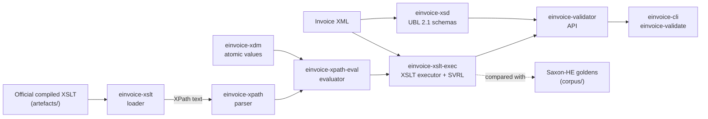

# einvoice-validator

Validate EN 16931 and Peppol BIS Billing 3.0 e-invoices against the **official** validation
artefacts, in pure Rust: no JVM, no C library, no FFI.

[](https://crates.io/crates/einvoice-validator)
[](https://crates.io/crates/einvoice-cli)
[](https://docs.rs/einvoice-validator)
[](https://github.com/einvoice-validator/einvoice-validator/actions/workflows/ci.yml)
[](LICENSE)

## Status

**Version 0.2.0, released on 2026-11-08** ([release notes](https://github.com/einvoice-validator/einvoice-validator/releases/tag/v0.2.0)):
the library is the crate [`einvoice-validator`](https://crates.io/crates/einvoice-validator)
(API documentation on [docs.rs](https://docs.rs/einvoice-validator)), the command-line tool
`einvoice-validate` the crate [`einvoice-cli`](https://crates.io/crates/einvoice-cli) (see
[Usage](#usage)); all nine crates of the workspace are published on crates.io at 0.2.0. Before
1.0.0, a minor version may break the public API ([RELEASING.md](RELEASING.md)). The library and the tool validate UBL 2.1 invoices and credit
notes (the XML, the UBL 2.1 schema, then the official stylesheets of the rule set) and, since
0.2.0, UN/CEFACT CII D16B invoices (the XML, then the official stylesheet:
the CII schemas are not embedded). The CEN EN 16931 UBL and CII 1.3.17 rule sets are built in, and the
tool picks one from each document's root element; Peppol BIS Billing 3.0.22 (its own rules and
the CEN rules it embeds) is used as a bundle built locally, since its files may not be
redistributed. Factur-X 1.09.2, XRechnung 3.0.2 and the French e-invoicing rules (FNFE-MPE
package 1.4.0.04) are used the same way, as bundles built locally (their stylesheets, and the
code lists the Factur-X ones read with `document()`). On every case of the test corpora of these
rule sets, the engine produces the same SVRL report as Saxon-HE (see the table below).

| Part | State |
|---|---|
| Test corpus of CEN EN 16931 UBL 1.3.17 (1179 cases, and 504 cases of our own made by mutating official examples) with the Saxon-HE results for each case | done |
| `einvoice-xdm`: XPath 2.0 atomic values with exact decimals, checked against Saxon-HE | done |
| `einvoice-xpath`: parser of the XPath 2.0 subset; parses every expression of the CEN 1.3.17 stylesheet | done |
| `einvoice-xslt`: loader of the XSLT 2.0 subset; loads the CEN 1.3.17 stylesheet | done |
| `einvoice-xpath-eval`: XPath 2.0 evaluator; agrees with Saxon-HE on every distinct expression of the CEN 1.3.17 stylesheet at nodes of corpus documents | done |
| `einvoice-xslt-exec`: XSLT executor and SVRL output | done |
| Same results as Saxon-HE on the whole CEN corpus | done: 1179 / 1179 cases and 504 / 504 mutation cases identical (the same SVRL, or the same error code where Saxon-HE stops with a dynamic error) ([#3](https://github.com/einvoice-validator/einvoice-validator/issues/3)) |
| Test corpus of Peppol BIS Billing 3.0.22 (707 cases, and 505 mutation cases), built locally from the pinned release (not redistributed) with the Saxon-HE results of both stylesheets | done ([#4](https://github.com/einvoice-validator/einvoice-validator/issues/4)) |
| Same results as Saxon-HE on the whole Peppol corpus | done: 707 / 707 cases and 505 / 505 mutation cases identical with each of the two stylesheets ([#5](https://github.com/einvoice-validator/einvoice-validator/issues/5), [#3](https://github.com/einvoice-validator/einvoice-validator/issues/3)) |
| `einvoice-xsd`: UBL 2.1 XML Schema validation against the official OASIS schemas; compared with xmllint on 1555 cases, every corpus case agrees, the other differences are listed with their cause (XAdES content is validated laxly: its schemas are not redistributable) | done ([#6](https://github.com/einvoice-validator/einvoice-validator/issues/6) follow-ups) |
| Public API (`einvoice-validator`: rule-set bundles, `Validator`, `Report`) and command-line tool (`einvoice-validate`); verdicts and findings agree with Saxon-HE on all 1179 CEN cases and 504 mutation cases and, with the Peppol bundle, on all 707 Peppol cases and 505 mutation cases | done ([#10](https://github.com/einvoice-validator/einvoice-validator/issues/10)) |
| Test corpus of CEN EN 16931 CII 1.3.17 (24 cases: the 15 examples and the 9 VEFA tests of the release, and 808 mutation cases of our own, [`corpus/mutations-cii.toml`](corpus/mutations-cii.toml)) with the Saxon-HE results; 785 of the 810 assert ids of the stylesheet fail in some case, the 25 others cannot ([`corpus/cen-en16931-cii-1.3.17/README.md`](corpus/cen-en16931-cii-1.3.17/README.md)) | done ([#12](https://github.com/einvoice-validator/einvoice-validator/issues/12)) |
| Same results as Saxon-HE on the whole CII corpus; built-in rule set `cen-cii` and detection of the syntax from the root element in `einvoice-validate` | done: 24 / 24 cases and 808 / 808 mutation cases identical, from the engine, the library and the tool ([#12](https://github.com/einvoice-validator/einvoice-validator/issues/12)); XML Schema validation of CII is not done: the UN/CEFACT D16B schemas are not embedded |
| WebAssembly build | done on `main`, not yet published: the library runs on `wasm32-unknown-unknown`, with the current date and time given by the caller (CI validates two corpus documents with the built-in rule set under wasmtime); the npm package `einvoice-validator` (crate `einvoice-wasm`, JavaScript and TypeScript bindings, for Node.js 22, browsers and bundlers, with `cen-ubl` and `cen-cii`) gives the Saxon-HE findings on all 2515 CEN UBL and CII cases under Node.js and in headless Chrome and Firefox ([#9](https://github.com/einvoice-validator/einvoice-validator/issues/9)) |
| Factur-X / ZUGFeRD / Order-X PDF files | done on `main`: `einvoice-pdf` extracts the embedded invoice XML and the XMP metadata in pure Rust; `einvoice-validate` and the library (feature `pdf`) validate a PDF through the XML it embeds ([#12](https://github.com/einvoice-validator/einvoice-validator/issues/12)) |
| Streaming XML parser (`einvoice-xml`) | done on `main`: checked against `roxmltree` on every XML file of the repository and on 133231 damaged documents, and against Saxon-HE; the validator reads each document with it, in one pass for the XML check and the XML schema, and builds the stylesheets' input tree from it; the SVRL report is kept compactly and its findings are read as the stylesheet writes it, without parsing it again: on an invoice of 5000 lines the peak heap of a validation drops from 9.5 to 2.1 times the document, the input tree alone being 1.9 times ([#18](https://github.com/einvoice-validator/einvoice-validator/issues/18)) |
| Factur-X 1.09.2 (ZUGFeRD 2.5.2): the stylesheets of the five profiles, 42 cases and 808 mutation cases with the Saxon-HE results; the 27 published examples are accepted by their profile | done on `main`: the corpus is built locally; the engine gives the Saxon-HE result on all 850 cases with each of the five stylesheets (4250 runs), the code lists read with `document()` from the bundle ([#24](https://github.com/einvoice-validator/einvoice-validator/issues/24), [#26](https://github.com/einvoice-validator/einvoice-validator/issues/26)) |
| XRechnung 3.0.2 (KoSIT validator configuration 2026-08-31, XRechnung Schematron 2.6.0), UBL and CII: 1882 cases (the test suite, 1733 mutants of the Schematron's own unit tests, each with its expectation) and 1312 mutation cases with the Saxon-HE results; the expectations and the test suite agree with Saxon-HE | done on `main`: the corpora are built locally; the engine runs the stylesheets compiled by SchXslt and gives the Saxon-HE result on all 3194 cases with both stylesheets of each syntax (6388 runs), `svrl:metadata` included ([#24](https://github.com/einvoice-validator/einvoice-validator/issues/24), [#27](https://github.com/einvoice-validator/einvoice-validator/issues/27), [#30](https://github.com/einvoice-validator/einvoice-validator/issues/30)) |
| French e-invoicing rules (FNFE-MPE package 1.4.0.04): CII, UBL, EXTENDED-CTC-FR, Factur-X, life-cycle statuses (CDAR); 198 cases and 1312 mutation cases with the Saxon-HE results; the 135 published examples are accepted | done on `main`: the corpora are built locally; the engine gives the Saxon-HE result on all 1510 cases with each of their stylesheets (8483 runs) ([#24](https://github.com/einvoice-validator/einvoice-validator/issues/24), [#28](https://github.com/einvoice-validator/einvoice-validator/issues/28)) |

Every open item is tracked in the [issues](https://github.com/einvoice-validator/einvoice-validator/issues);
changes are listed in [CHANGELOG.md](CHANGELOG.md).

## Usage

Install the command-line tool from crates.io (Rust 1.99 or later):

```sh
cargo install --locked einvoice-cli                  # installs einvoice-validate
```

or from a clone of this repository (the toolchain is pinned in `rust-toolchain.toml` and
installed by rustup on first use):

```sh
cargo install --locked --path crates/einvoice-cli    # installs einvoice-validate
```

```sh
einvoice-validate invoice.xml                        # cen-ubl or cen-cii, from the root element of the document
einvoice-validate factur-x.pdf                       # a Factur-X / ZUGFeRD / Order-X PDF: the invoice XML it embeds
einvoice-validate --rules cen-cii invoice.xml        # a built-in rule set by name: cen-ubl or cen-cii
einvoice-validate --format json --jobs 4 invoices/*.xml > report.json
einvoice-validate --format svrl - < invoice.xml      # the SVRL report, as the stylesheet wrote it
einvoice-validate --bundle DIR invoice.xml           # a rule-set bundle: DIR/bundle.toml and its stylesheets
einvoice-validate --max-depth 1000 deep.xml          # accept elements nested up to 1000 deep (default 256)
einvoice-validate --licences                         # the licences of everything the binary embeds, in full
```

```text
$ einvoice-validate invoice.xml broken.xml
invoice.xml: valid
broken.xml: invalid: 1 schema error, 11 fatal
  schema   2:1: missing-element: element ubl:Invoice: content incomplete; expected: ext:UBLExtensions, cbc:UBLVersionID, cbc:CustomizationID, cbc:ProfileID, cbc:ProfileExecutionID, cbc:ID
  ...
  fatal    BR-02: [BR-02]-An Invoice shall have an Invoice number (BT-1).
           at /*:Invoice[namespace-uri()='urn:oasis:names:specification:ubl:schema:xsd:Invoice-2'][1]
  ...
2 documents: 1 valid, 1 invalid, 0 not validated
```

Exit status, the highest that applies: `0` every document is valid (no schema error, no finding
with flag `fatal`); `1` a document is invalid (schema errors, fatal findings, or not well-formed
XML); `2` usage error, or a file or bundle that cannot be read or is not valid (a PDF file without
one embedded invoice included); `3` a construct the engine does not support (an encrypted PDF
file included), a document beyond a limit, a stylesheet error on a document, or an internal
error. A file that starts with `%PDF-` is validated through the invoice XML it embeds, and the
output adds what the PDF states about it (the embedded file, its `/AFRelationship`, the PDF/A
identification and the Factur-X / ZUGFeRD properties of its XMP metadata). Without
`--rules` or `--bundle`, each document is validated with the built-in rule set of its syntax:
`cen-ubl` for a UBL `Invoice` or `CreditNote`, `cen-cii` for a CII `CrossIndustryInvoice`
(namespace `urn:un:unece:uncefact:data:standard:CrossIndustryInvoice:100`), `cen-ubl` for
anything else; the JSON report names the rule set of each document. The options,
the output formats and the JSON format (versioned) are documented in
[`crates/einvoice-cli/README.md`](crates/einvoice-cli/README.md).

**Deeply nested documents.** A document with an element nested deeper than 256 levels (the
document element is at depth 1; libxml2's default limit) is refused before it is validated, with
the line and column of that element: `Error::Limit` in the library, exit status `3` in
`einvoice-validate`. `ValidateOptions::max_depth` and `--max-depth N` set another maximum. The
stylesheets recurse once or twice per element level, so the limit keeps a validation within a
bounded call stack: at the default maximum, it runs on a thread with the default 2 MiB stack, in
a debug build too. The stylesheets' template and function invocations are bounded as well, in
nesting and in the stack they use (`ValidateOptions::max_stack`, 1.5 MiB by default): a rule set
that recurses without end fails with `Error::Limit` instead of overflowing the stack.

**Peppol BIS Billing 3.0.** Its files carry no licence, so they are not part of this repository:
`scripts/fetch-peppol.sh` (needs Java and network access the first time) downloads the pinned
release, compiles its two stylesheets and writes, next to them, the `bundle.toml` that names
them with their checksums. The directory is then a bundle:

```sh
scripts/fetch-peppol.sh                     # into target/peppol/
einvoice-validate --bundle target/peppol/peppol-bis-billing-ubl-3.0.22 invoice.xml
```

**Library.** A `Validator` is built once from a rule set (schemas loaded, stylesheets prepared),
is `Send + Sync`, and validates any number of documents:

```toml
[dependencies]
einvoice-validator = "0.1"
```

```rust
use einvoice_validator::{Validator, Verdict};

fn main() -> Result<(), Box<dyn std::error::Error>> {
    // Built once: the UBL 2.1 schemas loaded, the CEN stylesheet prepared.
    // A Validator is Send + Sync: share it between threads.
    let validator = Validator::cen_ubl()?;
    let report = validator.validate(&std::fs::read("invoice.xml")?)?;
    for error in &report.schema_errors {
        println!("schema {}:{}: {}", error.line, error.column, error.message);
    }
    for finding in report.findings() {
        let id = finding.id.as_deref().unwrap_or("-");
        println!("{:?} {id}: {} (at {})", finding.severity, finding.text, finding.location);
    }
    println!("{}", if report.verdict() == Verdict::Valid { "valid" } else { "invalid" });
    Ok(())
}
```

`Validator::cen_cii()` is the CII rule set, and `Syntax::detect` tells from a document's root
element which of the two built-in rule sets is its own (`Validator::builtin(syntax.builtin_rule_set())`).
`Validator::from_bundle_dir` loads a bundle directory such as the Peppol one; the manifest format
is documented in the crate.

## Design

- **The official artefacts, unchanged.** The rule sets are published by their owners (CEN/TC 434,
  OpenPeppol) as Schematron, compiled to XSLT by CEN; the Peppol Schematron is compiled here
  with the ISO Schematron skeleton of ph-schematron, the output pinned by checksum. The engine
  is built to execute that compiled XSLT as is: no rule is translated into Rust by hand, so a
  new rule-set release needs new artefacts and new expected results, not new code.
- **Pure Rust.** No JVM, no C library, no FFI; `unsafe` code is forbidden in every crate.
- **Exact decimals.** `xs:decimal` and `xs:integer` are arbitrary precision, with the division
  precision, rounding and string forms of the reference engine: the amount and total rules
  compute exactly what Saxon-HE computes, never through floating point where the stylesheet
  asks for decimals.
- **Checked rule by rule against the reference engine.** The expected result of every test case
  is the SVRL report of Saxon-HE 12.10 running the same stylesheet, stored in a canonical
  text form. The goal is identical reports: the same fired rules, the same failed asserts and
  successful reports with the same id, flag, location and text, in the same order.
- **Loud refusal.** The engine implements the XPath and XSLT subset the official stylesheets
  use, and nothing is approximated: a construct outside that subset is an error at load time
  that names it and its line, and a value whose reference behaviour is not reproduced is
  refused rather than guessed.

## Rule sets and schemas

| Rule set or schema | Version | In this repository |
|---|---|---|
| CEN EN 16931, UBL syntax | 1.3.17 | Artefacts vendored unmodified in `artefacts/`; test corpus and Saxon-HE results in `corpus/`. Built into `einvoice-validator` as the rule set `cen-ubl` (default feature `cen-ubl`). |
| Peppol BIS Billing 3.0, UBL syntax | 3.0.22 | Not vendored: the upstream repository publishes no licence. `scripts/fetch-peppol.sh` fetches the pinned tag and compiles its two Schematron files to XSLT (ISO skeleton of ph-schematron) into `target/peppol/`, every input and output checked against a pinned checksum, with the `bundle.toml` that makes the directory a rule-set bundle; `scripts/check.sh peppol` builds the corpus and the Saxon-HE results there. |
| CEN EN 16931, UN/CEFACT CII D16B syntax | 1.3.17 | Artefacts vendored unmodified in `artefacts/` (the CII D16B schemas of the source archive excepted: they are UN/CEFACT works, and no schema validation is done for CII); test corpus, mutation cases and Saxon-HE results in `corpus/`. Built into `einvoice-validator` as the rule set `cen-cii` (default feature `cen-cii`), without a schema. |
| Factur-X / ZUGFeRD, CII syntax | Factur-X 1.09.2 | Not vendored: the official package is behind a registration form, and the example documents are AFNOR's (all rights reserved). `scripts/fetch-facturx.sh` takes the stylesheets of the five profiles from the Mustang validator 2.26.0 on Maven Central and the examples of XP Z12-012 and XP Z12-014 from `fnfe-mpe.org`, every input checked against a pinned checksum, with one rule-set bundle per profile; `scripts/check.sh facturx` builds the corpus and the Saxon-HE results in `target/facturx/` and runs the engine on it. |
| XRechnung, UBL and CII syntaxes | XRechnung 3.0.2 | Not vendored: the XRechnung Schematron includes rules derived from Peppol BIS Billing 3.0. `scripts/fetch-xrechnung.sh` fetches KoSIT's validator configuration, test suite and Schematron unit tests (expanded by XML Mutate) from KoSIT's GitLab, every input checked against a pinned checksum, with a bundle per syntax; `scripts/check.sh xrechnung` builds the corpora in `target/xrechnung/` and runs the engine on them. |
| French e-invoicing rules (XP Z12-012), CII, UBL and CDAR | FNFE-MPE package 1.4.0.04 | Not vendored: the licence statements of the package disagree, and the example documents are AFNOR's (all rights reserved). `scripts/fetch-fr-ctc.sh` fetches the package and the examples from `fnfe-mpe.org`, every input checked against a pinned checksum, with a bundle per profile; `scripts/check.sh fr-ctc` builds the corpora in `target/fr-ctc/` and runs the engine on them. |
| OASIS UBL 2.1 schemas (Invoice, CreditNote) | 2.1 | Vendored unmodified in `crates/einvoice-xsd/schemas/`, except the two ETSI XAdES schemas, which are not redistributable; `einvoice-xsd` validates against them. |

The pinned versions are listed in `upstream.toml`; a weekly workflow reports newer upstream
releases.

## How it works



| Crate | Role |
|---|---|
| [`einvoice-xdm`](crates/einvoice-xdm) | Atomic values of the XPath 2.0 data model: exact `xs:decimal` and `xs:integer`, `xs:double`, dates, casts, arithmetic, comparisons and XSD regular expressions, with the behaviour of Saxon-HE 12.10. |
| [`einvoice-xpath`](crates/einvoice-xpath) | Parser and syntax tree for the XPath 2.0 subset, XSLT match patterns, sequence types and attribute value templates. |
| [`einvoice-xpath-eval`](crates/einvoice-xpath-eval) | Node model and evaluator of the XPath 2.0 subset, with the behaviour of Saxon-HE 12.10; unknown functions and variables are refused when an expression is compiled. |
| [`einvoice-xslt`](crates/einvoice-xslt) | Loader for the XSLT 2.0 subset emitted by the Schematron compilers: templates, modes, priorities, functions, variables, parameters and instructions, each with its source line. |
| [`einvoice-xsd`](crates/einvoice-xsd) | XML Schema validation of UBL 2.1 Invoice and CreditNote documents against the official OASIS UBL 2.1 schemas, which it embeds; implements exactly the XML Schema 1.0 constructs those schemas use and refuses any other at load time. |
| [`einvoice-xslt-exec`](crates/einvoice-xslt-exec) | Executor of the XSLT 2.0 subset: runs the official compiled Schematron with the behaviour of Saxon-HE 12.10 and writes SVRL; constructs whose result would differ are refused when a stylesheet is prepared. |
| [`einvoice-svrl`](crates/einvoice-svrl) | The canonical, line-oriented form of SVRL reports ([`corpus/SVRL-CANONICAL.md`](corpus/SVRL-CANONICAL.md)) used to compare reports with the reference engine. |
| [`einvoice-validator`](crates/einvoice-validator) | The public crate: rule-set bundles (a `bundle.toml` manifest with the SHA-256 of each stylesheet and of each resource read with `document()`, from memory or a directory; CEN EN 16931 UBL and CII 1.3.17 built in), the `Validator` (XML check, the schema of the rule set if any, then each stylesheet; `Send + Sync`), the `Report` (schema errors, findings, SVRL, verdict) and `Syntax` (UBL or CII, from the root element). |
| [`einvoice-cli`](crates/einvoice-cli) | The `einvoice-validate` command-line tool: XML and PDF files and standard input, built-in rule sets (chosen from each document's root element by default) or bundle directories, several threads, text, JSON or SVRL output, documented exit codes. |
| [`einvoice-pdf`](crates/einvoice-pdf) | Extracts the embedded invoice XML and the XMP metadata of a Factur-X, ZUGFeRD or Order-X PDF/A-3 file, reading only the part of PDF on the path to embedded files and refusing anything else; bounded against hostile input. |
| [`einvoice-xml`](crates/einvoice-xml) | A streaming (pull) XML 1.0 parser with namespaces that builds no tree, with the verdicts and errors of `roxmltree` (stricter on a few constructs XML 1.0 forbids); every document the validator checks, validates against a schema or gives the stylesheets is read with it. |
| [`einvoice-wasm`](crates/einvoice-wasm) | The JavaScript and TypeScript bindings (`wasm-bindgen`) and the build of the npm package `einvoice-validator`; not published on crates.io. |
| [`einvoice-testkit`](crates/einvoice-testkit) | Helpers of the tests, not published: the workspace crates a package is built from (`cargo tree`), a writer of synthetic PDF files, and synthetic invoices with many lines. |
| [`xtask`](xtask) | Repository tooling, not published: artefact checksums, corpus extraction, the mutation catalogue, the Saxon-HE oracle, the VEFA cross-check. |

**Testing against the reference engine.** The corpus of each rule set holds the official example
documents, the official test files and one document per test of the official VEFA unit test
sets, plus cases of our own: catalogues of edits ([`corpus/mutations.toml`](corpus/mutations.toml)
for UBL, [`corpus/mutations-cii.toml`](corpus/mutations-cii.toml) for CII) applied to official
examples, aimed at what the rules check and where engines can diverge
(rounding, decimal precision, number and date forms, code lists, check digits, namespaces,
repeated elements). For each case, the golden file is the SVRL that Saxon-HE produces (or the
error that stops it), in the canonical form
of [`corpus/SVRL-CANONICAL.md`](corpus/SVRL-CANONICAL.md); it is committed for CEN UBL and CII, and built
in `target/` for Peppol, whose files may not be redistributed. CI re-runs Saxon-HE on every
case whenever the corpus or its tooling changes and fails if a committed golden differs,
cross-checks the goldens with the expectations written in the VEFA tests, and builds the Peppol
corpus whenever the engine changes, to check the engine against it. The crates are
checked the same way: `einvoice-xdm` against 5078 Saxon-HE results of atomic operations,
`einvoice-xpath-eval` against Saxon-HE's value of every distinct expression of the CEN
stylesheet at nodes of corpus documents. `einvoice-xsd` is compared with xmllint (libxml2) on
the corpus and on mutations of synthetic documents. See [`corpus/README.md`](corpus/README.md).

## Building and testing

Requirements: [rustup](https://rustup.rs/) (the toolchain, Rust 1.99.1, is pinned in
`rust-toolchain.toml` and installed on first use), `git` and `bash`. Optional: `cargo-deny`,
`actionlint`, `zizmor`, `jq`, ShellCheck and the `wasm32-unknown-unknown` target
(`rustup target add wasm32-unknown-unknown`): the checks that need them are skipped when they
are missing. Java with network access for the Saxon-HE oracle and the Peppol corpus (CI uses
Java 21, which regenerating the `einvoice-xdm` results needs), and `xmllint` for the xmllint
oracle of `einvoice-xsd` (its results were produced with libxml2 2.9.14), with `curl` and network
access the first time, to fetch the two XAdES schemas from OASIS; the tests themselves
need neither. For the npm package: Node.js 22 and npm, the pinned `wasm-bindgen-cli` and
`wasm-opt` (`crates/einvoice-wasm/npm.sh tools` installs them outside the repository), and
Chrome or Firefox for its browser test.

```sh
scripts/check.sh                          # every job below, as CI runs them
scripts/check.sh clippy test              # selected jobs
cargo test -p einvoice-xpath --test cen_1_3_17   # one test target
cargo test -p einvoice-xdm --test oracle         # einvoice-xdm against the Saxon-HE results
cargo test -p einvoice-xpath-eval --test oracle  # the evaluator against the Saxon-HE results
cargo test -p einvoice-xsd --test oracle         # einvoice-xsd against the xmllint results
```

| `scripts/check.sh` job | What it runs |
|---|---|
| `fmt` | `cargo fmt --all --check` |
| `clippy` | `cargo clippy --workspace --all-targets --all-features --locked -- -D warnings` |
| `doc` | `cargo doc --workspace --no-deps --all-features --locked` |
| `test` | `cargo test --workspace --all-targets --all-features --locked`, then the doctests |
| `features` | clippy and the tests of `einvoice-validator` with `--no-default-features` (no built-in rule set) |
| `wasm` | `cargo build --locked --target wasm32-unknown-unknown -p einvoice-validator -p einvoice-pdf -p einvoice-xml`, then the examples `wasm-smoke` (`einvoice-xpath-eval`), `wasm-validate` (`einvoice-validator`, the built-in rule set on two corpus documents), `wasm-extract` (`einvoice-pdf`, two PDF files built in memory) and `wasm-smoke` (`einvoice-xml`) built for that target: they must import nothing and return 0 under wasmtime (skipped locally without the target or wasmtime) |
| `npm` | `crates/einvoice-wasm/npm.sh build test pack`: the npm package built (opt-level 3, LTO, `wasm-bindgen`, `wasm-opt`), its Node.js tests (the API, the CEN UBL and CII corpora against the Saxon-HE goldens), a strict TypeScript check of its declarations, the browser test in headless Chrome and Firefox, then `npm pack --dry-run` (needs Node.js 22, npm, jq and the tools of `npm.sh tools`; skipped locally without them, and without a browser or TypeScript) |
| `package` | the publishable crates packaged as crates.io would receive them and built from their packages; each term of a crate's licence expression has its text in the package's `LICENSES/`, and each has a description, its README in the package, and one to five keywords and categories (needs `jq`) |
| `deny` | `cargo deny --all-features check`: licences, duplicates, sources, advisories |
| `actionlint` | `actionlint` on the GitHub workflows |
| `zizmor` | `zizmor --persona=pedantic` on the GitHub workflows and `.github/dependabot.yml` |
| `pins` | `scripts/freshness.sh pins` (every pin of `upstream.toml` matches the files that record it, offline) and the tests of `scripts/freshness.sh` (needs `jq`) |
| `guards` | ShellCheck on `scripts/*.sh`, `crates/*/*.sh` and `.githooks/*`, then the tests of the privacy guard and of the release scripts (need `jq`) |
| `oracle` | artefact checksums, corpus extraction and VEFA cross-check, then xmllint on the oracle cases of `einvoice-xsd` (needs `xmllint`, and `curl` and network access the first time), then Saxon-HE on every corpus case and on the probes of `einvoice-xdm`, `einvoice-xpath-eval` and `einvoice-xslt-exec`: the goldens must not change, and on the hand-written cases of `einvoice-xml` (its `saxon-check` example) (needs Java; each part skipped locally without its tool) |
| `peppol` | the Peppol corpus in `target/peppol/`: fetch and compile the pinned release, extract the cases, Saxon-HE with both stylesheets, VEFA cross-check, then the engine, and `einvoice-validate` with the Peppol bundle, must match every golden, mutation cases included (needs Java and network access the first time; skipped locally without them) |
| `privacy` | the repository's pre-commit checks on staged changes (maintainers; skipped when nothing is staged) |

The corpus and the oracle can also be run step by step:

```sh
cargo xtask manifest         # vendored artefacts match their SHA256SUMS
cargo xtask corpus           # corpus/*/cases.tsv, the extracted VEFA documents and the mutation cases are up to date
cargo xtask crosscheck       # goldens against the VEFA expectations
scripts/fetch-saxon.sh       # Saxon-HE 12.10 and the XML Resolver 5.3.3 from Maven Central into target/, checksums verified
cargo xtask oracle           # Saxon-HE on every case; the goldens must not change
scripts/fetch-peppol.sh      # Peppol BIS Billing release and its compiled stylesheets into target/peppol/, checksums verified
cargo xtask peppol           # Peppol corpus, Saxon-HE goldens and VEFA cross-check, in target/peppol/
cargo test -p einvoice-xslt-exec --test peppol_equivalence -- --nocapture   # the engine on the Peppol corpus
cargo test -p einvoice-xslt-exec --test mutation_equivalence -- --nocapture # the engine on the CEN and Peppol mutation cases
cargo test -p einvoice-xslt-exec --test cii_equivalence -- --nocapture      # the engine on the CII corpus and its mutation cases
cargo test -p einvoice-cli --test peppol_bundle -- --nocapture              # einvoice-validate with the Peppol bundle
cargo run --release -p einvoice-xsd --example xmllint-oracle                # xmllint on the oracle cases of einvoice-xsd
cargo run --release -p einvoice-xsd --example heap                          # heap of the UBL 2.1 schema and of validating the CEN corpus
```

## Repository layout

```text
crates/              the library crates and the command-line tool (see the table above); einvoice-xsd holds the UBL 2.1 schemas
xtask/               repository tooling (cargo xtask ...)
artefacts/           official validation artefacts, unmodified, with SHA256SUMS
corpus/              test cases and Saxon-HE goldens, one directory per rule set
scripts/             check.sh, fetch-saxon.sh, fetch-peppol.sh, freshness.sh, release scripts, git hook helpers
.githooks/           pre-commit, commit-msg and pre-push hooks
.github/workflows/   CI, oracle, upstream freshness, release, repository checks
upstream.toml        every pinned upstream version and the files that record it
```

## Quality bar

- Every compiler warning is an error; clippy's `all` and `pedantic` groups are denied, and so
  are `unwrap`, `expect`, `panic`, `todo` and `dbg!` outside tests. Exceptions are local
  `#[expect(lint, reason = "...")]` attributes next to the code they concern.
- `unsafe` code is forbidden. Integer overflow is checked in release builds too.
- Property tests (proptest) and golden tests against the reference engine.
- `cargo-deny`: dependencies under permissive licences only (today only MIT); the terms of
  the official files the crates embed are allowed only for the crates that embed them (the
  schema terms for `einvoice-xsd`; the EUPL-1.2 of the CEN stylesheets and the schema terms for
  `einvoice-validator`, `einvoice-cli` and `einvoice-wasm`), and the Unicode-3.0 of
  `unicode-ident`, used only by the macros of `wasm-bindgen` when `einvoice-wasm` is built, for
  that crate only; no duplicate versions, crates.io as the only source, advisories and yanked
  releases are errors.
- The toolchain is pinned, `Cargo.lock` is committed and every cargo command uses `--locked`.
- CI on GitHub-hosted runners: Linux for every check, macOS and Windows tests on pull requests.
  Actions are pinned by full commit SHA, run with minimal permissions and without persisted
  credentials, and the workflows are checked by actionlint and zizmor (pedantic).
- Pre-commit checks run as git hooks and again in CI. Dependabot and a weekly upstream check
  report new versions.

## Licences

- The code of this project is under the [MIT licence](LICENSE).
- `artefacts/cen-en16931-ubl-1.3.17/` and `artefacts/cen-en16931-cii-1.3.17/` hold files
  published by CEN/TC 434, vendored unmodified, under the European Union Public Licence 1.2
  (EUPL-1.2). `corpus/cen-en16931-ubl-1.3.17/` and `corpus/cen-en16931-cii-1.3.17/` are derived
  from them, their mutation cases included, and are EUPL-1.2 too. Each directory has a README
  with the provenance and a `LICENSE.txt`. The UN/CEFACT CII D16B schemas of the CEN source
  archive are not vendored.
- `einvoice-validator` embeds the CEN stylesheets of those two directories (EUPL-1.2), vendored
  unmodified in the crate (`crates/einvoice-validator/bundles/cen-ubl/` and `bundles/cen-cii/`),
  through its default features `cen-ubl` and `cen-cii`, which provide the built-in rule sets of
  the same names; so does the `einvoice-validate` binary, and through `einvoice-xsd` both embed
  the OASIS UBL 2.1 schemas. `einvoice-validator` and `einvoice-cli` are therefore licensed
  `MIT AND EUPL-1.2 AND LicenseRef-OASIS-Copyright-Notice AND LicenseRef-UN-CEFACT-Copyright-Notice AND W3C-19980720`,
  and so is the npm package `einvoice-validator` (crate `einvoice-wasm`), which embeds the same.
  Built with `default-features = false`, the library embeds no rule set and
  uses only the bundles it is given. Every crate ships the texts of its licences in its
  `LICENSES/` directory. `einvoice-validate --licences` prints the licences of everything the
  binary embeds (MIT, EUPL-1.2, and the OASIS, UN/CEFACT and W3C terms of the UBL 2.1
  schemas) in full, and `einvoice_validator::licences()` returns them to other programs.
- The `einvoice-validate` binary and the npm package are also compiled from crates of
  crates.io, each used under the MIT licence (and the Unicode licence v3 for the tables of
  `unicode-ident`). `crates/einvoice-cli/THIRD-PARTY-NOTICES` and
  `crates/einvoice-wasm/THIRD-PARTY-NOTICES` give, for each of them, its version, its licence,
  its authors and the text of that licence from its own package; `einvoice-validate --licences`
  prints the first after the licences above, and the npm package ships the second. Both are
  generated from `Cargo.lock`, and the tests fail when they are not up to date.
- Saxon-HE 12.10 (MPL-2.0) is the reference engine of the tests only, with the XML Resolver
  5.3.3 (Apache-2.0) it needs at run time. `scripts/fetch-saxon.sh` downloads them from Maven
  Central into `target/`; they are neither part of the repository nor distributed.
- Peppol BIS Billing 3.0 files are fetched at test time into `target/peppol/` and not
  redistributed; nothing derived from them (compiled stylesheets, extracted documents, goldens)
  is committed. The tools that compile their Schematron, ph-schematron-maven-plugin and Apache
  Maven (both Apache-2.0), are downloaded there too, for the tests only.
- `crates/einvoice-xsd/schemas/oasis-ubl-2.1/` holds thirteen of the fifteen schema documents
  of the OASIS UBL 2.1 Standard reachable from the Invoice and CreditNote schemas, vendored
  unmodified and embedded in `einvoice-xsd`. They are not under the MIT licence: each keeps the
  terms in its own header (OASIS, UN/CEFACT, W3C). The crate declares `MIT AND
  LicenseRef-OASIS-Copyright-Notice AND LicenseRef-UN-CEFACT-Copyright-Notice AND
  W3C-19980720`, with the texts in `crates/einvoice-xsd/LICENSES/`, as the README of the schema
  directory explains.
- The other two, the ETSI XAdES schemas of the OASIS package (`UBL-XAdESv132-2.1.xsd` and
  `UBL-XAdESv141-2.1.xsd`), are not redistributed: they carry no licence notice and the ETSI
  deliverable they come from allows no reproduction without written permission. `einvoice-xsd`
  therefore validates XAdES content (in UBL extensions and signatures) laxly; the README of the
  schema directory says what that means. The xmllint oracle of `einvoice-xsd` downloads the two
  files from OASIS (checksums verified) into `target/`, for the tests only.
- xmllint (libxml2) is the reference of the `einvoice-xsd` tests only; it is neither part of the
  repository nor a dependency.

## Contributing

Issues and pull requests are welcome. For a larger change, please open an issue first.

- `scripts/check.sh` must pass.
- Add an entry under `[Unreleased]` in [CHANGELOG.md](CHANGELOG.md) for any change users can
  notice; CI checks it on pull requests (a maintainer adds the label `no-changelog` when no
  entry is needed).
- Rules are never translated into Rust by hand: rule behaviour comes from the official
  artefacts, and a difference from Saxon-HE is a bug in the engine.
- Test documents must be synthetic or taken from the official published examples, never
  invoices of a real business.
- Signed commits are welcome.

Contributions are accepted under the MIT licence. Releases follow [RELEASING.md](RELEASING.md).

## Security

Please report vulnerabilities privately: see [SECURITY.md](SECURITY.md).
