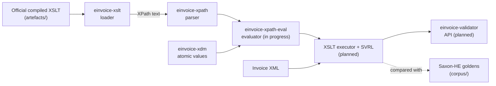

# einvoice-validator

Validate EN 16931 and Peppol BIS Billing 3.0 e-invoices against the **official** validation
artefacts, in pure Rust: no JVM, no C library, no FFI.

[](https://github.com/einvoice-validator/einvoice-validator/actions/workflows/ci.yml)
[](LICENSE)

## Status

**Pre-alpha. It does not validate invoices yet.** There is no release, no public API and no
command-line tool. What exists today is the foundation the validation engine is built on, and
the test corpus it will be judged against.

| Part | State |
|---|---|
| Test corpus of CEN EN 16931 UBL 1.3.17 (1179 cases) with the Saxon-HE results for each case | done |
| `einvoice-xdm`: XPath 2.0 atomic values with exact decimals, checked against Saxon-HE | done |
| `einvoice-xpath`: parser of the XPath 2.0 subset; parses every expression of the CEN 1.3.17 stylesheet | done |
| `einvoice-xslt`: loader of the XSLT 2.0 subset; loads the CEN 1.3.17 stylesheet | done |
| `einvoice-xpath-eval`: XPath 2.0 evaluator; agrees with Saxon-HE on every distinct expression of the CEN 1.3.17 stylesheet at nodes of corpus documents | in progress ([#1](https://github.com/einvoice-validator/einvoice-validator/issues/1)) |
| XSLT executor and SVRL output | planned ([#2](https://github.com/einvoice-validator/einvoice-validator/issues/2)) |
| Same results as Saxon-HE on the whole CEN corpus | planned ([#3](https://github.com/einvoice-validator/einvoice-validator/issues/3)) |
| Peppol BIS Billing 3.0.22: corpus, then same results as Saxon-HE | planned ([#4](https://github.com/einvoice-validator/einvoice-validator/issues/4), [#5](https://github.com/einvoice-validator/einvoice-validator/issues/5)) |
| UBL 2.1 XML Schema validation | in progress ([#6](https://github.com/einvoice-validator/einvoice-validator/issues/6)) |
| Public API and command-line tool | planned ([#10](https://github.com/einvoice-validator/einvoice-validator/issues/10)) |
| WebAssembly build | planned ([#9](https://github.com/einvoice-validator/einvoice-validator/issues/9)) |
| Other rule sets (CEN CII, XRechnung, Factur-X / ZUGFeRD) | planned ([#12](https://github.com/einvoice-validator/einvoice-validator/issues/12)) |

Every open item is tracked in the [issues](https://github.com/einvoice-validator/einvoice-validator/issues);
changes are listed in [CHANGELOG.md](CHANGELOG.md).

## Design

- **The official artefacts, unchanged.** The rule sets are published by their owners (CEN/TC 434,
  OpenPeppol) as Schematron compiled to XSLT. The engine is built to execute that compiled
  XSLT as published: no rule is translated into Rust by hand, so a new rule-set release needs
  new artefacts and new expected results, not new code.
- **Pure Rust.** No JVM, no C library, no FFI; `unsafe` code is forbidden in every crate.
- **Exact decimals.** `xs:decimal` and `xs:integer` are arbitrary precision, with the division
  precision, rounding and string forms of the reference engine: the amount and total rules
  compute exactly what Saxon-HE computes, never through floating point where the stylesheet
  asks for decimals.
- **Checked rule by rule against the reference engine.** The expected result of every test case
  is the SVRL report of Saxon-HE 9.9.1-8 running the same stylesheet, stored in a canonical
  text form. The goal is identical reports: the same fired rules, the same failed asserts and
  successful reports with the same id, flag, location and text, in the same order.
- **Loud refusal.** The engine implements the XPath and XSLT subset the official stylesheets
  use, and nothing is approximated: a construct outside that subset is an error at load time
  that names it and its line, and a value whose reference behaviour is not reproduced is
  refused rather than guessed.

## Rule sets

| Rule set | Version | In this repository |
|---|---|---|
| CEN EN 16931, UBL syntax | 1.3.17 | Artefacts vendored unmodified in `artefacts/`; test corpus and Saxon-HE results in `corpus/`. Engine in progress. |
| Peppol BIS Billing 3.0 | 3.0.22 | Planned. The upstream repository publishes no licence, so its files are not vendored: they will be fetched at test time from the pinned tag, with checksums. |
| CEN EN 16931 CII, XRechnung, Factur-X / ZUGFeRD | | Planned. |

The pinned versions are listed in `upstream.toml`; a weekly workflow reports newer upstream
releases.

## How it works



| Crate | Role |
|---|---|
| [`einvoice-xdm`](crates/einvoice-xdm) | Atomic values of the XPath 2.0 data model: exact `xs:decimal` and `xs:integer`, `xs:double`, dates, casts, arithmetic, comparisons and XSD regular expressions, with the behaviour of Saxon-HE 9.9.1-8. |
| [`einvoice-xpath`](crates/einvoice-xpath) | Parser and syntax tree for the XPath 2.0 subset, XSLT match patterns, sequence types and attribute value templates. |
| [`einvoice-xpath-eval`](crates/einvoice-xpath-eval) | Node model and evaluator of the XPath 2.0 subset, with the behaviour of Saxon-HE 9.9.1-8; unknown functions and variables are refused when an expression is compiled. |
| [`einvoice-xslt`](crates/einvoice-xslt) | Loader for the XSLT 2.0 subset emitted by the Schematron compilers: templates, modes, priorities, functions, variables, parameters and instructions, each with its source line. |
| `einvoice-xsd` | UBL 2.1 XML Schema validation; planned ([#6](https://github.com/einvoice-validator/einvoice-validator/issues/6)). |
| [`einvoice-validator`](crates/einvoice-validator) | The public crate; no API yet ([#10](https://github.com/einvoice-validator/einvoice-validator/issues/10)). |
| [`xtask`](xtask) | Repository tooling, not published: artefact checksums, corpus extraction, the Saxon-HE oracle, the VEFA cross-check. |

**Testing against the reference engine.** The corpus of each rule set holds the official example
documents, the official test files and one document per test of the official VEFA unit test
sets. For each case, the committed golden file is the SVRL that Saxon-HE produces, in the
canonical form of [`corpus/SVRL-CANONICAL.md`](corpus/SVRL-CANONICAL.md). CI re-runs Saxon-HE
on every case whenever the corpus or its tooling changes and fails if a golden differs, and
cross-checks the goldens with the expectations written in the VEFA tests. The crates are
checked the same way: `einvoice-xdm` against 5068 Saxon-HE results of atomic operations,
`einvoice-xpath-eval` against Saxon-HE's value of every distinct expression of the CEN
stylesheet at nodes of corpus documents. See [`corpus/README.md`](corpus/README.md).

## Building and testing

Requirements: [rustup](https://rustup.rs/) (the toolchain, Rust 1.99.1, is pinned in
`rust-toolchain.toml` and installed on first use), `git` and `bash`. Optional: `cargo-deny`,
`actionlint` and `zizmor` (their checks are skipped when missing), and Java with network access
for the Saxon-HE oracle (CI uses Java 21, which regenerating the `einvoice-xdm` results needs).

```sh
scripts/check.sh                          # every job below, as CI runs them
scripts/check.sh clippy test              # selected jobs
cargo test -p einvoice-xpath --test cen_1_3_17   # one test target
cargo test -p einvoice-xdm --test oracle         # einvoice-xdm against the Saxon-HE results
cargo test -p einvoice-xpath-eval --test oracle  # the evaluator against the Saxon-HE results
```

| `scripts/check.sh` job | What it runs |
|---|---|
| `fmt` | `cargo fmt --all --check` |
| `clippy` | `cargo clippy --workspace --all-targets --all-features --locked -- -D warnings` |
| `doc` | `cargo doc --workspace --no-deps --all-features --locked` |
| `test` | `cargo test --workspace --all-targets --all-features --locked`, then the doctests |
| `deny` | `cargo deny --all-features check`: licences, duplicates, sources, advisories |
| `actionlint` | `actionlint` on the GitHub workflows |
| `zizmor` | `zizmor --persona=pedantic` on the GitHub workflows |
| `oracle` | artefact checksums, corpus extraction and VEFA cross-check, then Saxon-HE on every corpus case and on the probes of `einvoice-xdm` and `einvoice-xpath-eval`: the goldens must not change (needs Java; skipped locally without it) |
| `privacy` | the repository's pre-commit checks on staged changes (maintainers; skipped when nothing is staged) |

The corpus and the oracle can also be run step by step:

```sh
cargo xtask manifest         # vendored artefacts match their SHA256SUMS
cargo xtask corpus           # corpus/*/cases.tsv and the extracted VEFA documents are up to date
cargo xtask crosscheck       # goldens against the VEFA expectations
scripts/fetch-saxon.sh       # Saxon-HE 9.9.1-8 from Maven Central into target/, checksum verified
cargo xtask oracle           # Saxon-HE on every case; the goldens must not change
```

## Repository layout

```text
crates/              the library crates (see the table above)
xtask/               repository tooling (cargo xtask ...)
artefacts/           official validation artefacts, unmodified, with SHA256SUMS
corpus/              test cases and Saxon-HE goldens, one directory per rule set
scripts/             check.sh, fetch-saxon.sh, freshness.sh, release scripts, git hook helpers
.githooks/           pre-commit, commit-msg and pre-push hooks
.github/workflows/   CI, oracle, upstream freshness, release, repository checks
upstream.toml        every pinned upstream version and the files that record it
```

## Quality bar

- Every compiler warning is an error; clippy's `all` and `pedantic` groups are denied, and so
  are `unwrap`, `expect`, `panic`, `todo` and `dbg!` outside tests. Exceptions are local
  `#[expect(lint, reason = "...")]` attributes next to the code they concern.
- `unsafe` code is forbidden. Integer overflow is checked in release builds too.
- Property tests (proptest) and golden tests against the reference engine.
- `cargo-deny`: permissive licences only (today only MIT), no duplicate versions, crates.io as
  the only source, advisories and yanked releases are errors.
- The toolchain is pinned, `Cargo.lock` is committed and every cargo command uses `--locked`.
- CI on GitHub-hosted runners: Linux for every check, macOS and Windows tests on pull requests.
  Actions are pinned by full commit SHA, run with minimal permissions and without persisted
  credentials, and the workflows are checked by actionlint and zizmor (pedantic).
- Pre-commit checks run as git hooks and again in CI. Dependabot and a weekly upstream check
  report new versions.

## Licences

- The code of this project is under the [MIT licence](LICENSE).
- `artefacts/cen-en16931-ubl-1.3.17/` holds files published by CEN/TC 434, vendored unmodified,
  under the European Union Public Licence 1.2 (EUPL-1.2). `corpus/cen-en16931-ubl-1.3.17/` is
  derived from them and is EUPL-1.2 too. Each directory has a README with the provenance and a
  `LICENSE.txt`.
- Saxon-HE 9.9.1-8 (MPL-2.0) is the reference engine of the tests only. `scripts/fetch-saxon.sh`
  downloads it from Maven Central into `target/`; it is neither part of the repository nor
  distributed.
- Peppol BIS Billing 3.0 files will be fetched at test time and not redistributed.
- The OASIS UBL 2.1 schemas are not in the repository. If they are vendored for XML Schema
  validation, they keep the OASIS copyright notice and terms.

## Contributing

Issues and pull requests are welcome. For a larger change, please open an issue first.

- `scripts/check.sh` must pass.
- Add an entry under `[Unreleased]` in [CHANGELOG.md](CHANGELOG.md) for any change users can
  notice; CI checks it on pull requests (a maintainer adds the label `no-changelog` when no
  entry is needed).
- Rules are never translated into Rust by hand: rule behaviour comes from the official
  artefacts, and a difference from Saxon-HE is a bug in the engine.
- Test documents must be synthetic or taken from the official published examples, never
  invoices of a real business.
- Signed commits are welcome.

Contributions are accepted under the MIT licence. Releases follow [RELEASING.md](RELEASING.md).

## Security

Please report vulnerabilities privately: see [SECURITY.md](SECURITY.md).
